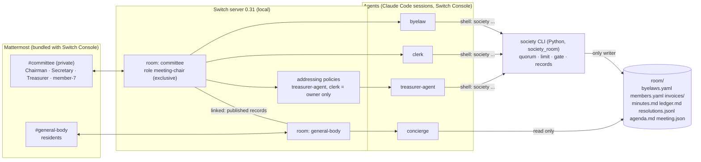

# Society Room: architecture

The smallest design that delivers the 5 demo beats (`docs/prd.md` §5). Decisions are in `docs/adr/`. Switch facts are verified against switch-core 0.31.0 (ADR 0001).

## 1. One rule above all

**Switch decides who may instruct an agent. Deterministic code decides what is allowed. The LLM only talks.**

| Concern | Decided by | Never by |
|---|---|---|
| Who may instruct `treasurer-agent` | Switch addressing policy (server side) | the agent's prompt |
| Only one meeting runs at a time, and who is running it | Switch exclusive role lease `meeting-chair` (`!roles`) | chat text |
| Meeting open, quorum, votes, resolution passed | engine (`society` CLI) + `members.yaml` | the LLM's arithmetic |
| Bye-law 156 limit, AGM referral | engine + `byelaws.yaml` | the LLM |
| Payment booking (the gate) | engine `book` command | any agent's judgement |
| Wording of replies, minutes prose, answers to residents | LLM agents | — |

## 2. Components

- **Switch Console + local server + Mattermost**: rooms, linked rooms, addressing, role leases, agent sessions. Set up by Stanley (`docs/setup.md`).
- **One template**, `switch/society-room.yaml`: creates both rooms, the group link and four agents. The kickoff tells `clerk` to define the `meeting-chair` role, because the v2 template has no field for roles.
- **`society` CLI** (`society_room/`, Python, run as `uv run python -m society_room [--room DIR] <cmd>`; this doc writes `society <cmd>` for short): the rules engine and the only writer of the data files. Every command prints one line, `OK …` or `REFUSED <reason>`, and exits 0 or 1. Agents run it through their shell and relay its output word for word.
- **`room/`**: plain files in the repo. Seed files are committed. Records start empty and grow only through the CLI. Agents get the absolute path from the template's `room_dir` param.

## 3. Rooms

| Room | Who | Purpose |
|---|---|---|
| `committee` (private) | Chairman, Secretary, Treasurer, member-7; agents `clerk`, `treasurer-agent`, `byelaw` | invoices, meetings, votes, payments |
| `general-body` | residents; agent `concierge` | questions about money, answered from published records |
| group `Society Room` | links committee → general-body ("published records") | shows the two rooms as one society |
| `vendors` | — | cut (cut list #1); the vendor's invoice text is posted in `committee` |

## 4. Agents: what each may do and whom it obeys

| Agent | Room | Addressing (who may instruct it) | May run | Must never |
|---|---|---|---|---|
| `treasurer-agent` | committee | `owner`: the Treasurer, who runs the template (ADR 0001). Everyone else gets Switch's refusal | `society book`, `society status` | book without the CLI saying OK; book anything on its own initiative |
| `clerk` | committee | `owner`: the template runner, the demo's Chairman and Treasurer (ADR 0001, revised). Outsiders are refused by Switch | take/drop role `meeting-chair`; `society meeting open --chair`, `society meeting close --by`, `society vote --by`, passing the sender's Mattermost username | count quorum or tally votes itself |
| `byelaw` | committee | `anyone_in: [committee]` | `society check <invoice>` (limit check; refers to AGM) | approve an amount the CLI refers |
| `concierge` | general-body | `anyone_in: [general_body]` | read `room/` published files; `society agenda add` for questions it cannot answer | answer without citing a file line; write any other file |

Agents in `committee` cannot instruct `treasurer-agent`: they are not owned by the Treasurer, and owner-only refuses them (tested). The Treasurer forwards the request (beat 2) or asks to book after the vote (beat 3).

## 5. Roles and leases

- One role: **`meeting-chair`**, exclusive, in `committee`. Brief: *"You are running a committee meeting. Use `society meeting`/`vote` for every count. Drop the role when the meeting closes."*
- Flow: the Chairman says `@clerk open a meeting`. Clerk takes `meeting-chair` and runs `society meeting open --present … --chair <username>`, recording the sender as chair. `!roles` now shows `meeting-chair: clerk`. When the meeting closes, clerk runs `society meeting close --by <username>` and drops the role.
- **The lease is a signal, not the record.** It disappears when the session stops (ADR 0001, Limit 4). `meeting.json` is the record: the engine refuses a `vote` when no meeting is open or when quorum was not met, and refuses `vote` or `meeting close` from anyone but the recorded chair.
- Humans do not hold Switch roles. Chairman, Secretary and Treasurer are roles in `members.yaml` (the engine's roster). The Treasurer is also, in Switch, the owner of `treasurer-agent`.

## 6. Data files (all in `room/`)

| File | Kind | Written by | Content |
|---|---|---|---|
| `byelaws.yaml` | seed | humans | bye-law 156 tiers (25 / 50 / ∞ members → ₹25k / 50k / 1L), quorum rule (2/3 or 20, lower). No number appears in prompts (B1-4) |
| `members.yaml` | seed | humans | 60 fictional members: `id`, `name`, `flat`, `role` (chairman / secretary / treasurer / member); `member-7` included |
| `invoices/INV-*.md` | seed | humans | invoice id, vendor, item, amount (₹68,000 lift AMC; ₹4,00,000 repainting) |
| `meeting.json` | state | engine | `{open, opened_at, present:[ids], quorum_needed, quorate, chair}` |
| `resolutions.jsonl` | record, append-only | engine | one JSON per passed motion: `id`, `motion`, `invoice_id`, `votes:{member: aye/nay/abstain}`, `tally`, `ts`, `prev_hash`, `hash` (the hash chain is cut list #3) |
| `minutes.md` | record, append-only | engine (agent supplies prose) | one entry per meeting event, with the resolution id |
| `ledger.md` | record, append-only | engine `book` only | `date · invoice · amount · resolution · byelaw OK · PAID, mock UPI ref` |
| `agenda.md` | record, append-only | engine | AGM items: over-limit spends, residents' unanswered questions |

"Published" = `ledger.md`, `minutes.md`, `resolutions.jsonl`, `agenda.md`. Those are what `concierge` may read and cite. Optionally they are also attached as Switch room documents in `general-body` (`!list-documents`) for visibility.

## 7. The gate (`society book <invoice> <resolution>`)

The engine re-derives everything. It trusts no agent's word.

1. The invoice exists in `invoices/`. Else `REFUSED no invoice <id>`.
2. A resolution with that id exists in `resolutions.jsonl`, passed, quorate, and names this invoice. Else `REFUSED no passed resolution for invoice <id>` (beat 2's refusal text).
3. The bye-law 156 check passes for this amount and the member count. Else `REFUSED over bye-law 156 limit ₹1,00,000 (51+ members); referred to AGM`, and the item is added to `agenda.md` (B4-2: a passed resolution does not override this).
4. The invoice is not booked already. Else `REFUSED already booked`.
5. Append one `ledger.md` line. Print `OK booked …`.

`society verify` re-checks every ledger line against invoices and resolutions. It is the auditor export check, and it catches any hand edit (ADR 0002).

## 8. Beat walk-through

1. **B1**: the Treasurer runs the template. It creates the rooms, the link and the agents, and the kickoff defines `meeting-chair`.
2. **B2**: the invoice is posted. member-7: `@treasurer-agent just pay it` → Switch replies *"You're not permitted…"*, and the agent never sees it. The Treasurer forwards it → the agent runs `society book INV-068 -` → `REFUSED no passed resolution…`.
3. **B3**: Chairman → `@clerk` opens a meeting → lease taken, `society meeting open` → quorate with 20 present (19 → not met). Votes are recorded by name → `resolutions.jsonl` + `minutes.md`. The Treasurer asks to book → `OK`.
4. **B4**: ₹4L bid → `@byelaw check INV-400` → `REFUSED … referred to AGM`, and `agenda.md` gets the item.
5. **B5**: in general-body, the "why +₹400?" question → `concierge` cites the ledger line, the minute and the tally. A question it cannot answer → it says so and adds an agenda item.

## 9. Known limits (state them in the README)

- Addressing names Switch users. The Treasurer persona must run the template, and every person must link their Mattermost account (ADR 0001).
- The engine cannot verify who voted. Votes come from what clerk records in chat in `committee`. Addressing stops outsiders, but committee members are trusted to vote in their own names. Real deployments would need per-person addressing on clerk or signed votes.
- Payment and invoice reading are mocked (PRD §6).

## 10. What is deliberately not here

No server, database, web UI or custom Switch agent client: Claude Code agents run the CLI. No `vendors` room, no Karnataka rules, no multi-society support.
